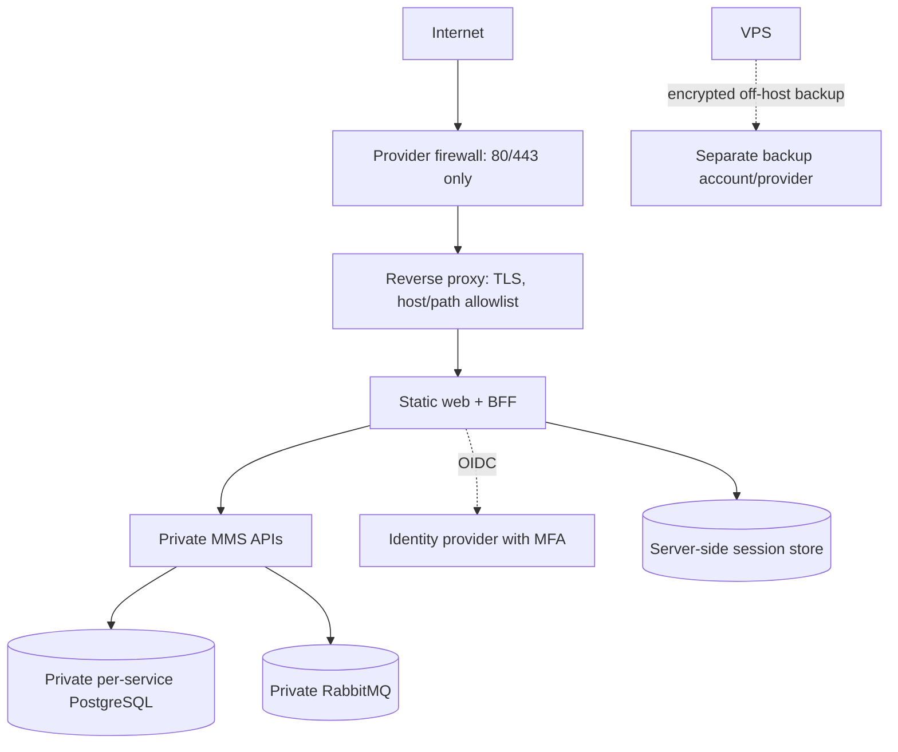

# MMS Production Security Architecture

**Status:** Proposed design; no controls in this document should be read as implemented.  
**Date:** 2026-10-12  
**Deployment target:** Internet-facing VPS, Docker Compose, one public web application, eight domain APIs, PostgreSQL databases, RabbitMQ.

## Executive design

Treat a single VPS as a constrained, single-failure-domain production deployment. The first release can be hardened for confidentiality and integrity, but it cannot provide host-level high availability: a host, disk, provider, or network failure takes the whole application offline. Use a provider-managed firewall, automatic encrypted off-host backups, monitoring from outside the VPS, and a tested rebuild/restore process. If the business requires continuous availability or a short recovery objective, move stateful services to managed/independent hosts and run application replicas across at least two failure zones.

Use a same-origin web Backend-for-Frontend (BFF) as the only public application entry point. Authenticate employees through OIDC; use opaque server-side sessions in secure cookies; derive all actor identity from a verified principal. The BFF and every API enforce authentication and authorization. Keep app services, databases, RabbitMQ, and management interfaces on a private Docker network and bind host ports only to loopback when host access is required. Put a maintained TLS reverse proxy on the public interface. Apply deny-by-default network and application rules.

## Scope and repository assessment

The repository contains eight domain services (Vendor Management, Inventory, Procurement, Receiving, Warehouse Operations, Retail Sales, Sales Audit, Financials), a Vite/React web client, per-service PostgreSQL ownership, and RabbitMQ events. The current Compose file is a development stack: it publishes PostgreSQL and RabbitMQ ports and uses simple default credentials. It is not a production deployment manifest.

The current APIs do not consistently authenticate callers. Existing `actorId`, `x-actor-id`, and configured browser actor values are audit metadata supplied by the caller; they are forgeable and must not be treated as identity or authorization. OpenAPI contracts do not yet declare a common security scheme. No production BFF, ingress, TLS configuration, authorization middleware, or distributed rate limiter is present. Zod validation, idempotency, domain audit logs, and transactional event patterns provide useful foundations, but coverage is incomplete. Existing local `.env.example` and development secrets are not production secret management.

This assessment is based on repository configuration, not a live VPS, DNS, provider firewall, identity-provider, or backup audit.

## VPS network and host boundary

### Public ingress

- The provider firewall permits inbound TCP 80 and 443 only. SSH is restricted to a VPN, fixed administrator IPs, or a provider console and key-based access; disable password SSH and root login. Do not expose application ports, database ports, RabbitMQ 5672/15672, Redis, Docker API, or monitoring/admin endpoints.
- Run Caddy or another maintained reverse proxy on the host or in a hardened container. Automate certificate issuance/renewal, redirect HTTP to HTTPS, reject unknown hostnames, cap request/header/body sizes, set upstream timeouts, and forward only required headers. Trust client IP and HTTPS headers only from the proxy hop.
- Proxy only explicit web/BFF routes and health endpoints. Never make the Vite dev server or development proxy reachable in production. Do not expose a generic `/proxy/:service` route.
- Bind reverse proxy ports on public interfaces; bind backend host mappings (if any) to `127.0.0.1`. Prefer no host mappings for internal containers. Attach only required containers to the private application network; isolate database and broker networks where practical.
- Run Docker with a non-root application user, read-only root filesystems where feasible, dropped Linux capabilities, `no-new-privileges`, resource limits, health checks, and bounded log rotation. Pin images to reviewed versions/digests and update on a defined patch schedule. Do not mount the Docker socket into application containers.

### Host operations

- Use a supported Linux LTS image with unattended security updates, host firewall, time synchronization, disk/CPU/memory monitoring, and alerts for disk exhaustion, failed services, certificate expiry, and backup failure.
- Administrative access uses named accounts, SSH keys, MFA at the provider, and a documented break-glass path. Keep an inventory of people with VPS/provider/DNS/backup access and remove access promptly when roles change.
- Store production configuration outside source and images with root-only permissions. Compose secrets are acceptable only with the caveat that they are files on the same host; for stronger isolation use a secret manager or host-level secret injection. Never commit `.env`, private keys, OIDC client secrets, database passwords, or broker credentials.
- Treat one VPS as not HA. Document Recovery Point Objective (RPO) and Recovery Time Objective (RTO), and validate them by timed restore drills. Backups must be encrypted and off-host, with credentials separate from the VPS and protection against deletion by a compromised host.

## Identity and authorization

### Employees and browser sessions

- Use a supported OIDC identity provider; do not implement password storage or token issuance in MMS. Require MFA for all users where possible and especially for finance approvers, administrators, and privileged operators. Disable accounts at the IdP promptly when employment or access ends.
- Implement a same-origin BFF that performs Authorization Code flow with PKCE (S256). Keep OIDC tokens server-side. The browser receives only a random opaque session cookie with `Secure`, `HttpOnly`, `SameSite=Lax`, narrow path, and no broad domain. Rotate on login and privilege changes; set idle and absolute expiration; revoke server-side on logout and account disablement. Never put long-lived tokens in localStorage.
- Cookie-authenticated writes require a CSRF token and Origin validation. With a same-origin BFF, disable CORS by default. If a separately approved browser origin is needed, use an exact allowlist and never wildcard credentialed CORS.
- Resolve the OIDC subject to an internal employee identity server-side. Construct a typed principal containing stable subject/employee ID, roles/permissions, and assigned store/location context. Reject missing, invalid, expired, wrong-issuer, wrong-audience, or wrongly signed identity. Do not trust forwarded identity headers unless the receiving service is reachable only from the trusted BFF and the header is cryptographically authenticated.

### Service authorization

- Deny by default. The owning service checks permission, object ownership, resource fields, and store/location scope for every route and requested object. The BFF may reject unauthenticated requests and perform coarse checks, but is not a replacement for service-local authorization.
- Replace actor IDs from headers and bodies with a principal derived from verified identity. Keep audit metadata distinct from credentials. Automated workloads use a service identity and explicit action context, not a fabricated human actor.
- Start with narrow domain permissions such as `purchase-orders.approve`, `inventory.adjust`, `sales.refund`, `sales-audit.approve`, and `financials.journal.post`. Avoid a universal `admin` permission. Scope policies by location/store and workflow state.
- Enforce separation of duties and sensitive thresholds in domain services and database transactions: a creator cannot approve their own PO/invoice/session; refunds, stock adjustments, period close/reopen, journal posting, and overrides require their own permission and immutable audit entry. UI visibility and feature flags do not grant access.
- Do not expose a service publicly before its authentication and authorization migration is complete. A temporary development identity stub must be local-only and impossible to enable through production configuration.

### Service and event identities

- For a single-host Compose deployment, private Docker networking plus unique credentials and strict ACLs are the minimum internal boundary. Use TLS for remote database/broker connections and encrypt host disks/backups. If the VPS provider or network is not trusted, use workload mTLS or short-lived audience-restricted service tokens as well; do not rely on private IP alone.
- Give each service distinct database credentials with only its own database/schema privileges. Runtime credentials must not be superusers or migration owners. Give each RabbitMQ publisher/consumer a dedicated user/vhost and least-privilege configure/write/read permissions; disable the management listener externally and rotate credentials.
- Validate every event at consumption, deduplicate by event ID, and treat event actor fields as provenance/audit context, not authorization. Enforce producer permissions and monitor dead-letter queues. Never allow arbitrary network clients to publish trusted business events.
- Internal HTTP calls authenticate the calling service. When acting for a human, carry a verifiable delegated principal or signed context so the target service can authorize and audit the human action. Never accept an unverified `x-actor-id` as proof.

## Application and data protections

- Standardize runtime validation of path, query, headers, and body for every public and internal API. Validate inter-service responses, messages, and startup configuration at their receiving boundary. Apply explicit per-route body limits, upload limits, pagination caps, query timeouts, request timeouts, and concurrency limits.
- Add a consistent error contract with safe messages and request IDs. Never return stack traces, SQL, secrets, internal addresses, or configuration. Log detailed diagnostics only in protected logs.
- Apply security headers: a CSP compatible with the built app, HSTS after HTTPS is correct, `X-Content-Type-Options: nosniff`, frame protection, and a restrictive Referrer Policy. Avoid unsafe inline scripts. Serve only built production assets.
- Use parameterized SQL, least privilege, database constraints for uniqueness/state transitions, and short transactions. Preserve service-owned database boundaries. Set explicit pool limits/timeouts and budget aggregate pool connections against each database capacity.
- Use idempotency keys for retryable writes, backed by durable unique constraints and request hashes. This is especially important for checkout, refunds, approvals, adjustments, and financial posting. Do not assume rate limiting prevents duplicate operations.
- Encrypt database storage and backups; classify employee, supplier, financial, and retail data; minimize sensitive data in logs/events; establish retention and deletion rules. Do not store payment card data unless a separately assessed payment architecture requires it.
- Use a centralized, access-controlled log destination if available; on a single VPS also use rotated local logs and off-host forwarding. Never log cookies, bearer tokens, secrets, or unrestricted request bodies. Business audit records remain in their owning service and must use verified actors.

## Abuse resistance and monitoring

- Apply edge limits by IP and authenticated subject, then tighter per-action quotas in services. IP is supplemental because stores may share NAT. Bound expensive reports, exports, search ranges, payload sizes, concurrent jobs, and downstream calls. Return 429 with `Retry-After`.
- A single-VPS Redis instance is not HA; do not make it a new single point of correctness. If Redis backs sessions, protect it on a private network and define recovery behavior. High-risk writes should fail closed if required identity/session validation is unavailable. Define a conservative emergency request cap if a shared limiter fails.
- Set dependency connection/read/write timeouts, bounded retries with jitter only for safe or idempotent operations, circuit breakers, and graceful shutdown. Do not report success when the transaction or outbox commit failed. Alert on repeated authorization denials, login sprays, unusual refunds/adjustments, sensitive period operations, 5xx/429 spikes, queue backlog/dead letters, resource exhaustion, and backup failures.
- Add correlation IDs end to end. Security events record verified actor/service, operation, resource, outcome, timestamp, and request ID, without credentials or sensitive payloads.

## Data, secrets, and recovery

- Run encrypted daily database backups and point-in-time/WAL archiving where supported. Copy encrypted backups off the VPS to a separately controlled account/provider. Include configuration needed to rebuild but exclude ephemeral credentials where they can be rotated. Test restoration of every service database and RabbitMQ recovery/replay procedures on a clean host.
- Keep a recovery runbook: provision clean OS, patch and harden, restore secrets from trusted source, deploy pinned images, restore databases, replay outbox/events safely, verify health, rotate credentials, and update DNS. Monitor that backups are recent, complete, decryptable, and restorable.
- Patch the OS, Node runtime, base images, and dependencies promptly for security issues. Produce an SBOM and scan dependencies/container images in CI. Require reviewed changes, protected release credentials, CI secret masking, and no production secrets in build artifacts. Roll back using known-good immutable images and database-compatible migration plans.
- Define incident steps for suspected credential disclosure, compromised user, malicious image, database exposure, and VPS compromise: isolate ingress, revoke IdP sessions and secrets, preserve logs/backups, rebuild from trusted images, assess integrity, and notify stakeholders as required.

## Deployment profiles

### Secure single-VPS launch

Suitable only when an outage during host repair/recovery is acceptable. One VPS runs reverse proxy, BFF/web, APIs, databases, and RabbitMQ in private containers; only TCP 80/443 and restricted SSH are public. Keep off-host backups and external monitoring. The host, local disk, Docker engine, and local data services remain shared failure points. A VPS-side Redis, local DB replica, or second container does not remove these failure points.

### Higher-availability target

For production workloads requiring bounded host failure: separate public ingress and application replicas across hosts/zones; use managed or independently hosted HA PostgreSQL, RabbitMQ, session storage, secrets, and backups. Keep the same identity and service-local authorization model. Define measured SLO, RPO, and RTO before selecting replicas and failover automation.

## Ordered implementation plan

1. **Before exposing the VPS:** create production-only deployment config; close all ports except 80/443 and restricted SSH; remove default credentials; deploy TLS reverse proxy; ensure backend containers have no public port mappings; set backups, external monitoring, host patching, and restore procedure.
2. **Identity foundation:** choose OIDC provider and employee identity mapping; implement BFF, secure sessions, CSRF, MFA policy, principal middleware, and production-safe configuration validation.
3. **Protect every API:** add authentication and deny-by-default service authorization; remove reliance on caller-provided actor IDs; migrate API contracts; add object/location/store checks and maker-checker rules. Keep all routes private until their service is complete.
4. **Workloads and events:** add unique service/database/broker credentials, RabbitMQ ACLs, trusted delegated actor propagation, and event provenance/validation.
5. **Bound and observe:** standardize schemas, limits, timeouts, pool budgets, safe errors, security logs, alerting, dependency and image scanning, and rotation procedures.
6. **Operational readiness:** conduct threat modeling for financial posting, approvals, stock changes, refunds and identity lifecycle; exercise incident response, restore and credential rotation; document residual single-VPS risks and recovery objectives.
7. **Scale when warranted:** move stateful services and app replicas off the host according to availability and capacity measurements rather than assuming container replicas on one VPS provide HA.

## Production release gates

- Only the reverse proxy is publicly reachable on web ports; SSH is restricted; direct probes cannot reach services, databases, RabbitMQ, cache, Docker, or admin tools.
- Every production route requires a verified human or workload principal and local permission checks; no actor header/body value grants identity.
- OIDC issuer/audience/signature/expiry are checked; MFA and account disablement are operational; sessions are secure, revocable, time-bounded, and CSRF-protected.
- Object, field, store/location access, maker-checker, and high-impact transaction invariants are enforced server-side and transactionally.
- Unique production credentials are least-privilege, protected, rotatable, and absent from repo/images/browser bundles/logs.
- Input and event boundaries have schemas, explicit size/time/concurrency limits, safe errors, idempotency, and monitoring.
- Encrypted off-host backups have been restored successfully on a clean environment; incident, rebuild, credential rotation, and event replay procedures are documented.
- The business owner accepts the measured single-host outage risk or the deployment has moved to a multi-host/managed HA profile.

## References

- IETF, [OAuth 2.0 Security Best Current Practice (RFC 9700)](https://www.rfc-editor.org/rfc/rfc9700/)
- OWASP, [API Security Top 10 (2023)](https://owasp.org/API-Security/editions/2023/en/0x11-t10/)
- OWASP, [REST Security Cheat Sheet](https://cheatsheetseries.owasp.org/cheatsheets/REST_Security_Cheat_Sheet.html)
- OWASP, [Session Management Cheat Sheet](https://cheatsheetseries.owasp.org/cheatsheets/Session_Management_Cheat_Sheet.html)
- OWASP, [CSRF Prevention Cheat Sheet](https://cheatsheetseries.owasp.org/cheatsheets/Cross-Site_Request_Forgery_Prevention_Cheat_Sheet.html)
